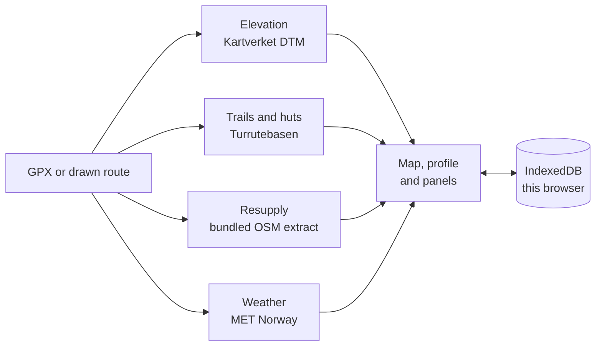

# TruHiker

A route planner for long-distance walking in Norway. Load a GPX or draw one, edit
it, and see the elevation, the resupply gaps, the food you must carry and the
weather the walk will face.

<!-- One screenshot, full width. Side-by-side shots become unreadable at README size. -->


## What it does

- **Routes.** Start a new route, import GPX or GeoJSON, or draw on the map. The
  editor shows the trip and its legs, and only the actions that apply to what you
  have selected: move, insert, split, reverse, trim, merge, undo. Snapping follows
  mapped trails; where no trail is near, the line is dashed and marked off-trail.
- **Routing.** Pick two points and follow mapped Turrutebasen trails. Where no
  trail connects them, the app says so instead of drawing a line.
- **Elevation.** From Kartverket's national 1 m terrain model, sampled live:
  profile, ascent, descent, grade and walking time.
- **Resupply.** Shops, fuel, post points and huts along the corridor, drawn on the
  map by kind, with the
  distance along the route, the detour, and the gap to the next usable point.
- **Energy.** Calories as a range, the intake ceiling, the food mass per leg and
  the projected weight change. When the deficit cannot be eaten away, it says so.
- **Weather.** MET Norway's forecast day by day along the route — and nothing at
  all beyond its ten-day reach.

## How it works



Everything runs in the browser. There is no account, no database and no server-side
storage of routes; a trip lives in IndexedDB and can be downloaded as GPX.

Six services are called directly by the browser — Kartverket's basemap and
elevation, Turrutebasen's trails and huts, Mapterhorn's terrain, MET Norway's
weather, and EOX's Sentinel-2 aerial mosaic. One data set is bundled: an OpenStreetMap extract of Norwegian resupply
points. Nothing else is copied or re-hosted.

## Run it

Node 22 or newer.

```bash
npm install
npm run dev            # http://localhost:5173
```

```bash
npm test               # hermetic, no network
npm run verify         # types, tests, build, budget, browser gates, licences
npm run build          # static build into dist/
npm run preview        # serve the build
```

One command reaches the network on purpose:

```bash
npm run test:live     # real Kartverket and MET requests
```

**The data files are build outputs, not repository files** (D24). `npm run build`
needs `data/shops.osm.bin` and its provenance, so a fresh clone has two ways to get
them (the deploy pipeline does the first automatically, D23):

```bash
npm run data:build                            # rebuild from the Geofabrik PBF
OSM_PBF=/path/to/norway-latest.osm.pbf npm run data:build

TRUHIKER_DATA_URL=https://... npm run build    # or fetch a published, pinned copy
```

Either way the result is verified against `tools/data-manifest.json` before
anything is served, and a build with no data fails loudly rather than shipping an
empty index.

## Deploy

```bash
npm run build
npx wrangler deploy
```

## Limits

- Routing uses Turrutebasen marked trails only, for a box up to 1.5° around the
  two points. Where the network does not connect them, it says so; it never
  bridges a gap or draws a straight line. OSM is not used, and that is measured
  rather than assumed: its path layer is mapped as chains, not a network (in
  Jotunheimen 470 paths share only 414 nodes — 72 components, 31 % of drawn pairs
  routable, against Turrutebasen's 23 components and 67 %). See D25.
- **Drawing** is click-by-click with a live preview to the snapped cursor; a
  double-click finishes the leg. There is no freehand drag and no keyboard way to
  place a vertex, and the trail network is fetched only at z10 and above, so a
  country-sized view is a picture of shops, not of trails.
- **The trail network shown on the map is the network that will be used**: the
  same lines the pointer snaps to. It is hidden in view mode, because a trail the
  app is not going to route on is decoration.
- Routing endpoints are placed with the pointer; there is no keyboard way to
  pick them yet.
- Planning only: there is no offline mode for use on the trail.
- **Basemap.** Kartverket topo in colour or grey, plus a **Flyfoto** layer from
  the Sentinel-2 cloudless mosaic (© EOX, CC BY 4.0). It is 10 m imagery capped at
  z14, so it shows the valley, not the bridge. Norway's own orthophoto is served
  only to Norge digitalt subscribers (D17).
- In 3D, labels near the horizon are soft: a raster tile draped over terrain is
  minified there, and this style carries no vector label layer (D18).
- Elevation covers mainland Norway.
- A hut's food status is not published as data, so a hut never counts as resupply
  unless you opt in.
- Weather outside the forecast horizon is shown as unknown, not estimated.
- All figures are estimates.

## Data and attribution

| Source | Used for | Licence |
| --- | --- | --- |
| **Kartverket** — topo, DTM, Turrutebasen | basemap, elevation, trails and huts | CC BY 4.0 · ©Kartverket |
| **MET Norway** | weather forecasts | NLOD / CC BY 4.0 |
| **Mapterhorn** | 3D terrain (derived from Kartverket) | derived; see `docs/LICENSES.md` |
| **OpenStreetMap contributors** | resupply points | ODbL 1.0 · © OpenStreetMap contributors |

Attribution is part of the interface: the map footer names Kartverket and
Mapterhorn, and **About data** (*Om data*) lists every source with its licence and
a link.

Two data sets ship with the app:

- **Demo route** — *Memurubu–Glitterheim* (`jot21`), real trail geometry from
  Kartverket Turrutebasen, CC BY 4.0, maintained by DNT Oslo og omegn.
- **Resupply points** — a derivative database of OpenStreetMap, served under
  ODbL 1.0. Refreshed **monthly**: a cron Worker (`worker/`) posts a Cloudflare
  Deploy Hook, and a Workers Builds job rebuilds `data/shops.osm.bin` from the
  current Geofabrik extract and redeploys (`npm run refresh:shops` does the same
  locally). The reasoning and the free-plan arithmetic are in D23.

## How it was built

With an AI coding agent working against a written specification.
