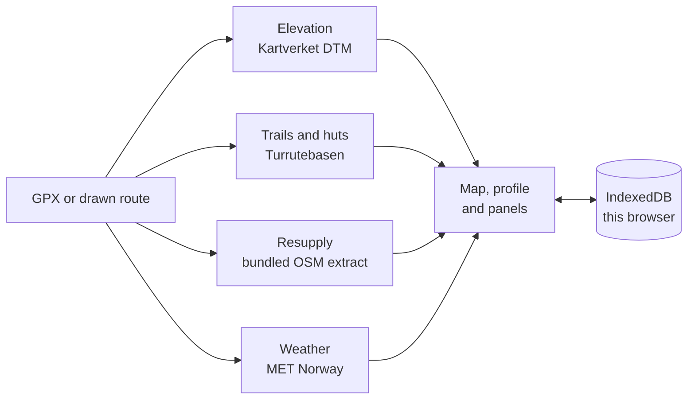

# TruHiker

A route planner for long-distance walking in Norway. Load a GPX or draw one, edit
it, and see the elevation, the resupply gaps, the food you must carry and the
weather the walk will face.

<!-- One screenshot, full width. Side-by-side shots become unreadable at README size. -->


## What it does

- **Routes.** Import GPX, KML or GeoJSON, or draw on the map. Move, insert, split,
  reverse, trim, merge and undo. Snapping follows mapped trails; where no trail is
  near, the line is dashed and marked off-trail.
- **Elevation.** From Kartverket's national 1 m terrain model, sampled live:
  profile, ascent, descent, grade and walking time.
- **Resupply.** Shops, fuel, post points and huts along the corridor, with the
  distance along the route, the detour, and the gap to the next usable point.
- **Energy.** Calories as a range, the intake ceiling, the food mass per leg and
  the projected weight change. When the deficit cannot be eaten away, it says so.
- **Weather.** MET Norway's forecast day by day along the route — and nothing at
  all beyond its ten-day reach.

## How it works



Everything runs in the browser. There is no account, no database and no server-side
storage of routes; a trip lives in IndexedDB and can be downloaded as GPX.

Four data sources are called directly by the browser — Kartverket (basemap, trails,
elevation), Mapterhorn (terrain), MET Norway (weather) — and one is bundled: an
OpenStreetMap extract of 8,571 resupply points, built once and served as a normal
asset. Nothing else is copied or re-hosted.

## Run it

Node 22 or newer.

```bash
npm install
npm run dev            # http://localhost:5173
```

```bash
npm test               # hermetic, no network
npm run verify         # types, tests, build, bundle, licences, hosting
npm run build          # static build into dist/
npm run preview        # serve the build
```

Two commands reach the network on purpose:

```bash
npm run test:live                       # real Kartverket and MET requests
npm run profile -- path/to/route.gpx    # elevation profile as JSON
```

## Deploy

```bash
npm run build
npx wrangler deploy
```

Static assets only — no Worker script, no KV, no R2. The build is 19 files,
about 0.58 MB compressed.

## Limits

- Snapping, not routing: the app will not plot a path between two arbitrary points.
- Planning only: there is no offline mode for use on the trail.
- Elevation covers mainland Norway.
- A hut's food status is not published as data, so a hut never counts as resupply.
- Weather outside the forecast horizon is shown as unknown, not estimated.
- All figures are estimates.

Data sources, licences and the exact attribution shown in the app are listed
under **Om data** in the application.
