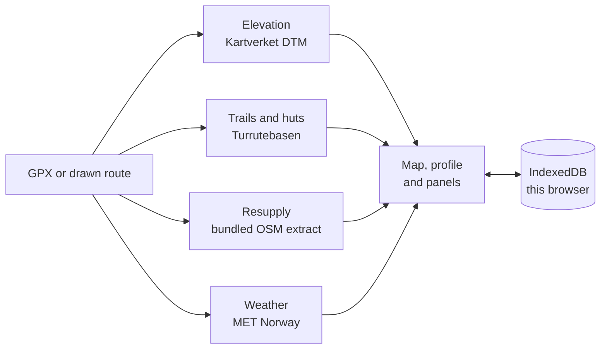

# TruHiker

A browser-only route planner for multi-day walking in Norway. Load a GPX or draw a
route, and get the elevation, the resupply gaps, the food you have to carry and the
weather the walk will face — and, where the data does not know something, the word
*unknown* rather than a plausible number.


## What it does

- **Routes.** Import GPX or GeoJSON, or draw on the map with a live preview of the
  next segment. Clicks snap to mapped trails, and when both ends of a step snap, the
  step follows the trail rather than cutting across it. Where no trail is near, the
  line is dashed and labelled *off-trail*. The editor shows the trip and its legs
  and only the actions that apply to your selection.
- **Routing.** Pick two points and follow Turrutebasen's marked trails. Where no
  trail connects them, it says so — it never bridges a gap or draws a straight line.
- **Elevation.** From Kartverket's national 1 m terrain model, sampled live:
  profile, ascent, descent, grade and walking time.
- **Resupply.** Shops, fuel, post points and huts around the route, drawn on the map
  by kind, with each point's distance along the route, its detour and the gap to the
  next usable point.
- **Energy.** Calories as a range, the intake ceiling, the food mass per leg and the
  projected weight change. When the deficit cannot be eaten away, it says so.
- **Weather.** MET Norway's forecast day by day along the route — and nothing at all
  beyond its ten-day reach.

## Honest by design

These are the rules the product is built around, and the tests pin them:

- an unknown value is `null`, never `0` — a missing ascent prints `—`, not `0 m`;
- weather beyond the forecast horizon carries no numeric fields at all;
- a hut is **not** food (its staffing and opening hours are not published data), and
  an unmanned fuel station counts for nothing;
- a partial ascent is unknown, not a smaller number;
- a route exists only where the fetched trail graph connects the endpoints;
- every live source is named in the interface, with the time it answered.

## Quick start

Node 22 or newer; a browser with WebGL2 and IndexedDB.

```bash
npm ci
```

The resupply data is a **build output, not a repository file** (D24), so a fresh
clone needs it once — pick one:

```bash
OSM_PBF=/path/to/norway-latest.osm.pbf npm run data:build   # rebuild from the Geofabrik extract
bash tools/refresh-shops.sh                                 # or download the extract and rebuild
```

Then:

```bash
npm run dev            # http://localhost:5173
npm run verify         # THE gate: types, tests, build, budgets, browser gates, licences
```

`npm run build` produces `dist/` and refuses to ship an unverified or empty data
index; `npm run preview` serves the build. If dependencies or data are missing, the
first command tells you exactly which and how to fix it.

| Command | What it does |
| --- | --- |
| `npm run dev` | Vite dev server |
| `npm run build` | typecheck, bundle, copy data and licences into `dist/` |
| `npm run verify` | the release gate — run this before claiming anything works |
| `npm test` | hermetic suite: no network, 283 cases, ~3 s |
| `npm run test:live` | opt-in: real Kartverket and MET requests |
| `npm run data:build` | rebuild the resupply extract from `$OSM_PBF` |
| `npm run perf` | timing budgets under throttled Slow 4G (needs the live tile hosts) |
| `npm run size` | per-asset bundle report |
| `npm run e2e` / `a11y` / `visual-check` | individual browser gates |

## Deploy

Static **Cloudflare Workers Assets** only — no Worker script for the app, no
server. `wrangler.jsonc` declares no `main`.

```bash
npm run build
npx wrangler deploy
```

The resupply extract refreshes monthly: a cron Worker posts a Cloudflare Deploy
Hook, a Workers Builds job rebuilds the artefact and redeploys (D23). That is a
second deploy, with its own secrets:

```bash
npx wrangler secret put DEPLOY_HOOK_URL -c worker/wrangler.jsonc
npx wrangler secret put TRIGGER_KEY     -c worker/wrangler.jsonc
npm run deploy:cron
```

Cache policy lives in `public/_headers`, and the runtime is what decides it: a
`_headers` block applies its headers only to the **last** pattern it lists, so each
pattern has its own block. `tools/verify/served-headers.mjs` asserts the served
`Cache-Control` for a hashed `.js`, `.mjs`, `.css`, the data files, `/` and a 404,
under `wrangler dev` — the source text cannot be trusted for this.

## Limits

- **Routing** uses Turrutebasen marked trails only, for a box up to **1.5° per side,
  1.5 deg² and 5 000 features**. OSM is not used, and that is measured rather than
  assumed: its path layer is mapped as chains, not a network (Jotunheimen: 470 paths
  sharing 414 nodes — 72 components, 31 % of point pairs routable, against
  Turrutebasen's 23 components and 67 %). See D25.
- **Drawing** is click-by-click: a preview follows the snapped cursor, and a step
  that snaps at both ends follows the trail. Double-click, or the **Fullfør** button,
  ends the leg. There is no freehand drag and no keyboard way to place a vertex.
  Dragging a vertex needs a pointer; on touch, a vertex can be selected but not yet
  dragged.
- **The trail network** is fetched from z10 upward and drawn only while it is
  actionable (draw or edit with snapping on) — a line the app will not route on is
  not shown. Turrutebasen is a shared public service: if it stops answering you get
  a banner within 12 s, a retry, and drawing continues without snapping.
- **Elevation** covers mainland Norway. A long route can take tens of seconds to
  profile; the panel says *Henter høydedata …* while it does.
- **Weather** stops at MET's horizon; outside it there are no numbers.
- **3D:** labels near the horizon are soft — a raster tile draped over terrain is
  minified there, and this style carries no vector label layer (D18).
- **Saving** is local and debounced by one second; an edit made in the last moment
  before you close the tab can be lost (D6). Nothing is uploaded anywhere.
- **Hosting** is at a domain root. Asset URLs are relative, but the data path and
  `_headers` patterns are absolute, so a sub-path deployment is not supported.
- All figures are estimates. None of it replaces a map, a compass and your own
  judgement.

## Data and attribution

| Source | Used for | Licence |
| --- | --- | --- |
| **Kartverket** — WMTS `topo`/`topograatone`, WMS `topo` fallback | basemap | CC BY 4.0 · ©Kartverket |
| **Kartverket** — WMS `sentinel2` (2025 mosaic) | the Flyfoto layer | Open data; credit *Copernicus Sentinel-2 / Kartverket* |
| **Kartverket** — Turrutebasen (WFS) | trail geometry, huts, routing | CC BY 4.0 · ©Kartverket |
| **Kartverket** — `hoydedata.no` DTM | elevation profile | CC BY 4.0 · ©Kartverket |
| **Mapterhorn** | 3D terrain | © Mapterhorn, attribution required (derived from open data incl. Kartverket) |
| **MET Norway** | weather forecasts | NLOD / CC BY 4.0 |
| **OpenStreetMap contributors** | resupply points (bundled) | ODbL 1.0 · © OpenStreetMap contributors |

Attribution is part of the interface: the map footer names ©Kartverket and
© Mapterhorn, and **About data** (*Om data*) lists every source with its licence and
a link.

**One data set ships with the app:** the resupply extract, a derivative database of
OpenStreetMap under **ODbL 1.0**. It is served at `/data/shops.osm.bin` with its
provenance at `/data/shops.osm.json` and the licence text at `/data/ODbL-1.0.txt` —
that public copy is the offer ODbL requires. It is generated at build time and never
committed; `tools/data-manifest.json` holds the pin (SHA-256, size, counts, source
date) that every build verifies.

The application itself is proprietary: © Sivert Asakskogen, all rights reserved. The
full inventory of what ships, with each obligation, is in
[docs/LICENSES.md](docs/LICENSES.md); the notices travel with the build at
`/licences/`.

## Privacy and network

The trip lives in this browser's IndexedDB. There is no account, no database, no
analytics and no third-party script. To draw a map and compute a plan, route
positions are sent to the services above — Kartverket (basemap, elevation, trails),
Mapterhorn (terrain) and MET (weather) — and nothing else leaves the browser. The
Content-Security-Policy in `public/_headers` names those six origins and no others.

## How it is put together



```
src/contracts   the document types every module shares (Trip, Leg, RoutePoint, EditCommand)
src/core        geodesy, TIFF, DEM sampling, profile
src/snap        Turrutebasen client, GML, spatial index, snapping, IndexedDB cache
src/route       immutable trip, commands, undo/redo, re-snap, routing (graph + A*)
src/store       IndexedDB, localStorage migration, GPX/GeoJSON IO
src/resupply    shop binary, corridor, live huts, plan
src/plan        energy, nutrition, resupply arithmetic
src/weather     MET client, cache, horizon discipline
src/lib         route geometry, elevation client, share encoding, chart, sync, format
src/ui          panels and dialogs (DOM, no framework)
src/app         orchestration and application state
src/map         MapLibre integration
```

Reasoning and defaults live in [docs/DECISIONS.md](docs/DECISIONS.md) (D1–D26), the
module boundaries and invariants in [docs/ARCHITECTURE.md](docs/ARCHITECTURE.md), and
the rules for changing this repository in [AGENTS.md](AGENTS.md).

## Quality gate

`npm run verify` runs fifteen checks: preflight, typecheck, the hermetic suite, the
build, the dist budget, a headless render at 1440 and 390 under the **real CSP**,
the end-to-end journey, axe plus a keyboard-only path, data integrity against the
pin, a deploy dry run, every failure path, i18n parity, the licence audit, the served
cache headers and the hosting contract.

Current numbers: 283 test cases (budget 320), `dist` 18 files at ~605 KB brotli
(budget 620 KB), JS 472 KB brotli (budget 500 KB). Timing is checked separately by
`npm run perf`: FCP 608 ms, map interactive 6.1 s and 425 KB of JS on throttled
Slow 4G — `perf` needs the live tile hosts, so it is a release-checklist step rather
than a gate step, and the architecture doc says so.

What the gate deliberately does **not** prove: the live services behave (they are
tolerated failures, and `failure-paths` simulates refusal, not a hang), touch input
or a second browser engine, a real screen reader, 3D terrain switched on, or the
cron Worker. Those are known gaps, listed in `docs/ARCHITECTURE.md`, not hidden.

## How it was built

With an AI coding agent working against a written specification, a test budget and a
licence rule — the commit history is the record of what was tried and why.
