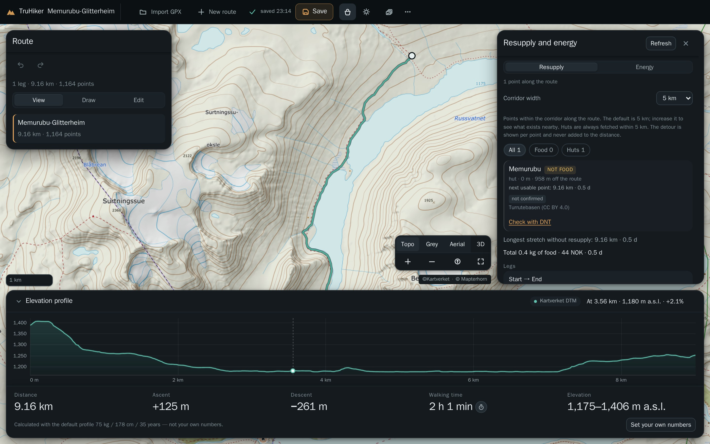

# TruHiker

A browser-only route planner for multi-day walking in Norway. Load a GPX or draw a
route, and get the elevation, the resupply gaps, the food you have to carry and the
weather the walk will face — and, where the data does not know something, the word
*unknown* rather than a plausible number.



## What it does

- **Routes.** Import GPX or GeoJSON, or draw on the map. Clicks snap to mapped
  trails, and a step that snaps at both ends follows the trail instead of cutting
  across it. Where no trail is near, the line is dashed and labelled *off-trail*.
- **Routing.** Pick two points and follow the marked trails. Where no trail
  connects them, it says so — it never bridges a gap or draws a straight line.
- **Elevation.** Profile, ascent, descent, grade and walking time, from
  Kartverket's national terrain model.
- **Resupply.** Shops, fuel, post points and huts around the route, by kind, with
  each point's distance along the route, its detour and the gap to the next one.
- **Energy.** Calories as a range, the intake ceiling, the food mass per leg and the
  projected weight change. When the deficit cannot be eaten away, it says so.
- **Weather.** MET Norway's forecast day by day along the route — and nothing at all
  beyond its ten-day reach.

## Honest by design

These are the rules the product is built around, and the tests pin them:

- an unknown value is `null`, never `0` — a missing ascent prints `—`, not `0 m`;
- weather beyond the forecast horizon carries no numeric fields at all;
- a hut is **not** food (its staffing and opening hours are not published data), and
  an unmanned fuel station counts for nothing;
- a partial ascent is unknown, not a smaller number;
- a route exists only where the fetched trail graph connects the endpoints;
- every live source is named in the interface, with the time it answered.

## Quick start

Node 22 or newer; a browser with WebGL2 and IndexedDB.

```bash
npm ci
npm run dev            # http://localhost:5173
```

The resupply points are built rather than committed, so a fresh clone needs them
once: `npm run refresh:shops` downloads the OpenStreetMap extract and builds the
file. If anything is missing, the first command tells you what and how to fix it.

```bash
npm run build          # typecheck, bundle, copy data and notices into dist/
npm run verify         # the release gate: run this before claiming anything works
```

| Command | What it does |
| --- | --- |
| `npm run dev` | Vite dev server |
| `npm run build` | build `dist/` |
| `npm run verify` | the release gate |
| `npm test` | the hermetic suite: no network |
| `npm run test:live` | opt-in: real Kartverket and MET requests |
| `npm run preview` | serve the build |

## Deploy

Static **Cloudflare Workers Assets** only — no server. `wrangler.jsonc` declares no
`main`.

```bash
npm run build
npx wrangler deploy
```

The resupply extract refreshes monthly from a scheduled worker; the mechanics are
in [docs/ARCHITECTURE.md](docs/ARCHITECTURE.md).

## Data and attribution

| Source | Used for | Licence |
| --- | --- | --- |
| **Kartverket** — topo map, Sentinel-2 aerial, Turrutebasen trails, elevation model | basemap, trails, elevation | CC BY 4.0 · ©Kartverket |
| **Mapterhorn** | 3D terrain | attribution required, derived from open data |
| **MET Norway** | weather forecasts | NLOD / CC BY 4.0 |
| **OpenStreetMap contributors** | resupply points (bundled) | ODbL 1.0 |

Attribution is part of the interface: the map footer names ©Kartverket and
© Mapterhorn, and **About data** (*Om data*) lists every source with its licence and
a link.

The resupply points are the only dataset bundled with the app; everything else is
fetched live from the service that owns it and never stored or re-served.

The licence for the application's own code has not been decided yet. The inventory
of what ships and what each licence obliges us to do is in
[docs/LICENSES.md](docs/LICENSES.md).

## Privacy and network

The trip lives in this browser's IndexedDB. There is no account, no database, no
analytics and no third-party script. To draw a map and compute a plan, route
positions are sent to Kartverket (basemap, elevation, trails), Mapterhorn (terrain)
and MET (weather) — and nothing else leaves the browser.

## Limits

- **Routing** uses Kartverket's marked trails, within a box of about 1.5° per side.
  OpenStreetMap is not used; the reasoning is D25 in
  [docs/DECISIONS.md](docs/DECISIONS.md).
- **Drawing** is click-by-click, and a step that snaps at both ends follows the
  trail. Double-click, or **Fullfør**, ends the leg. There is no freehand mode and
  no keyboard way to place a vertex; dragging a vertex needs a pointer, and on
  touch a vertex can be selected but not yet dragged.
- **Elevation** covers mainland Norway. A long route can take tens of seconds to
  profile; the panel says *Henter høydedata …* while it does.
- **Weather** stops at MET's horizon; outside it there are no numbers.
- **Saving** is local and debounced by one second, so an edit made in the last
  moment before you close the tab can be lost. Nothing is uploaded anywhere.
- **3D:** labels near the horizon are soft — a raster tile draped over terrain is
  minified there.
- **Hosting** is at the root of a domain, and the app also runs under a path prefix;
  only the caching and security headers then have to be set at the proxy instead.
- All figures are estimates. None of it replaces a map, a compass and your own
  judgement.

## Docs

[docs/DECISIONS.md](docs/DECISIONS.md) records every default a user could reasonably
expect to differ, [docs/ARCHITECTURE.md](docs/ARCHITECTURE.md) the module boundaries
and what the release gate does and does not prove, [docs/LICENSES.md](docs/LICENSES.md)
the licence inventory, and [AGENTS.md](AGENTS.md) the rules for changing the
repository.

## How it was built

AI-driven development.
